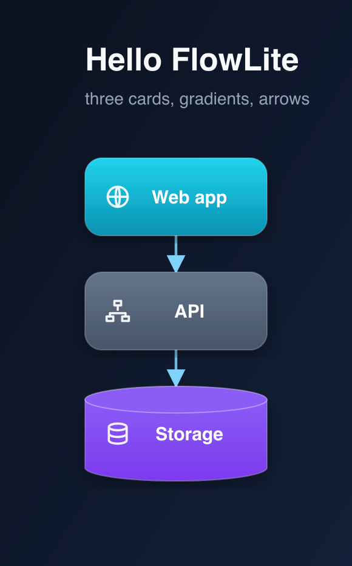
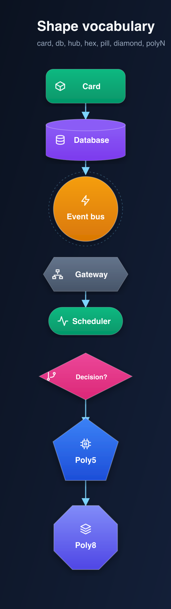
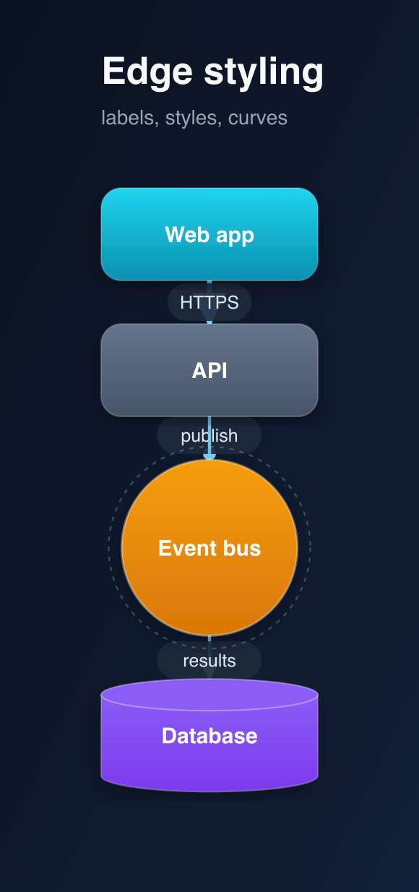
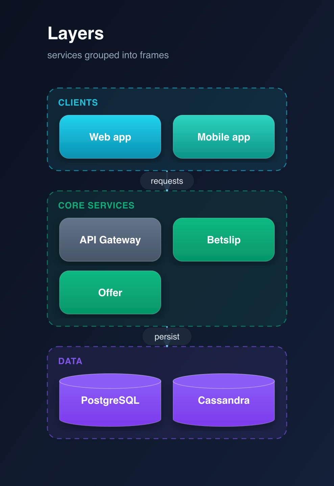
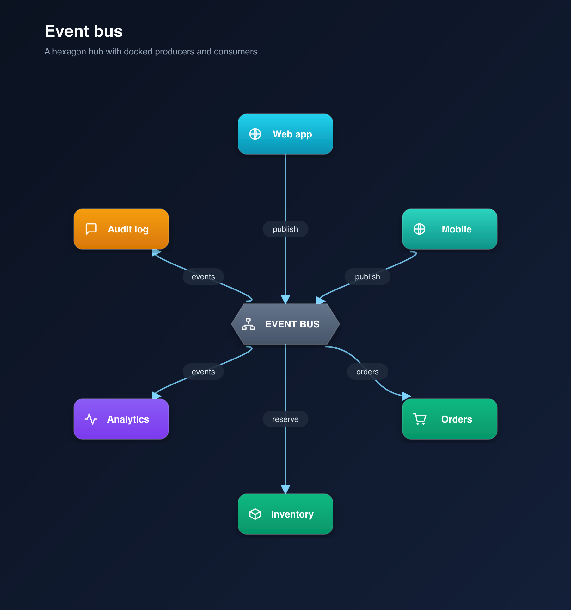
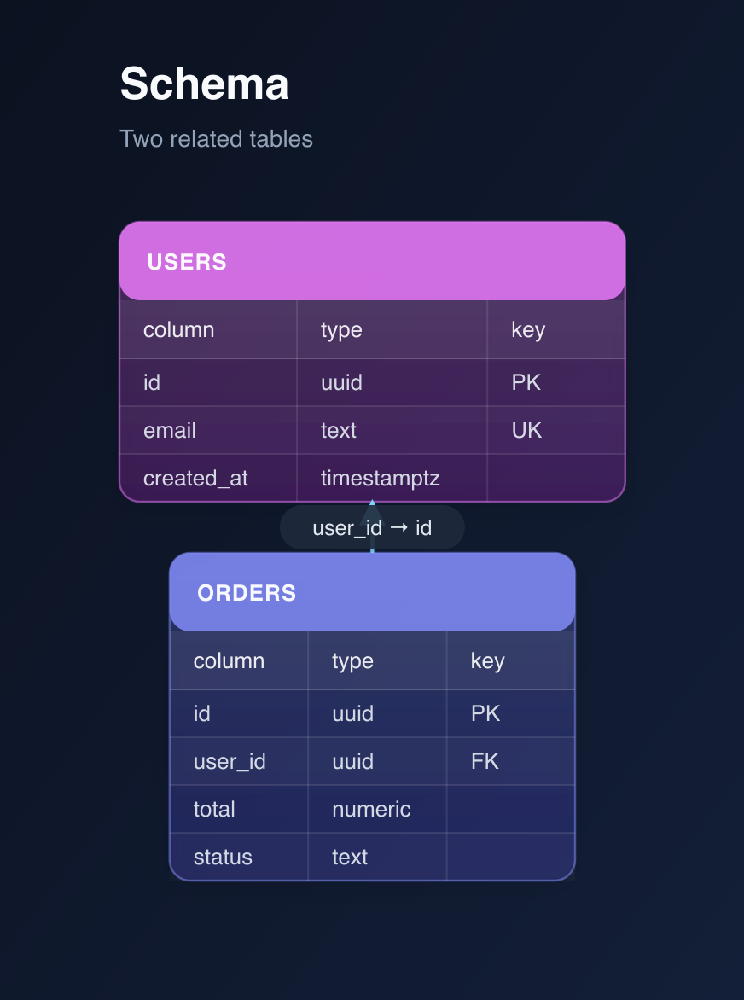
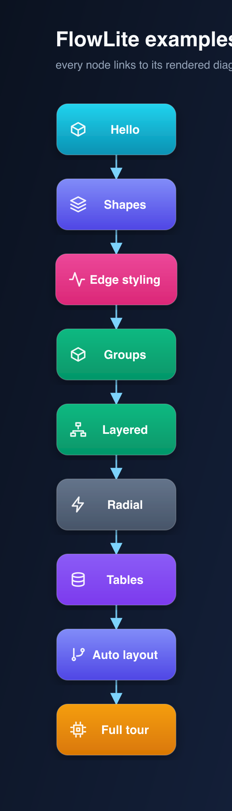
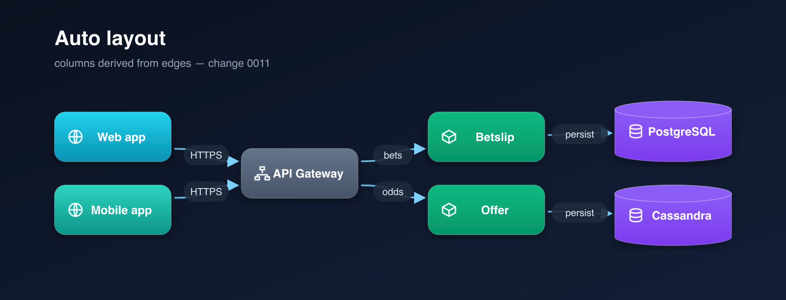
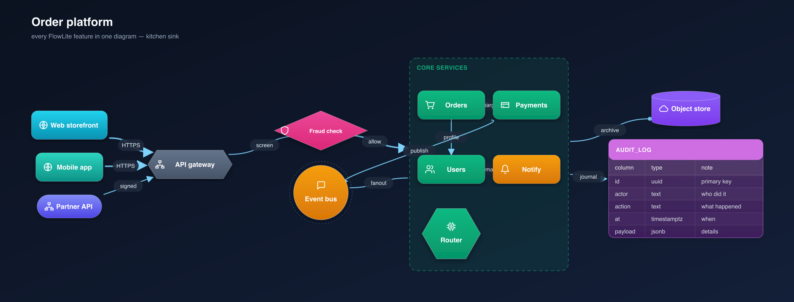

# Gallery

Every example in [`examples/`](../examples/) is compiled and shown here. The
gallery grows with the tool — each change adds at least one rendered example
(see the golden rule in [`openspec/changes/README.md`](../openspec/changes/README.md)).

> Each change adds at least one rendered example (see the golden rule in
> [`openspec/changes/README.md`](../openspec/changes/README.md)). Every example
> is committed as **both** an `.svg` (readable vector — open it in your IDE or
> browser) and a `.png`, under `docs/img/`.

## 0001 — Walking skeleton

**`hello.fl`** — three gradient cards stacked vertically with arrows and
kind-tinted icons.

_Source: [`examples/hello.fl`](../examples/hello.fl) ·
Output: [`docs/img/hello.svg`](img/hello.svg)_

---

## 0002 — Shapes

**`shapes.fl`** — the shape vocabulary: `card`, `db`, `hub`, `hex`, `pill`,
`diamond` and regular polygons (`poly5`, `poly8`).

_Source: [`examples/shapes.fl`](../examples/shapes.fl) ·
Output: [`docs/img/shapes.svg`](img/shapes.svg)_

---

## 0003 — Edge styling

**`flow.fl`** — labelled edges with bold/dashed strokes, dot/no arrow heads and a
straight curve.

_Source: [`examples/flow.fl`](../examples/flow.fl) ·
Output: [`docs/img/flow.svg`](img/flow.svg)_

---

## 0004 — Groups

**`layers.fl`** — services grouped in translucent frames.

_Source: [`examples/layers.fl`](../examples/layers.fl) ·
Output: [`docs/img/layers.svg`](img/layers.svg)_

---

## 0005 — Layered layout

**`pipeline.fl`** — clients, services and data in ordered left-to-right columns.

_Source: [`examples/pipeline.fl`](../examples/pipeline.fl) ·
Output: [`docs/img/pipeline.svg`](img/pipeline.svg)_

---

## 0006 — Radial layout

**`hub.fl`** — a hexagonal event bus with producers and consumers spread on a
ring, spokes docked to the polygon's faces.

_Source: [`examples/hub.fl`](../examples/hub.fl) ·
Output: [`docs/img/hub.svg`](img/hub.svg)_

---

## 0007 — Tables

**`schema.fl`** — two related tables (`users`, `orders`) with a header row, cell
grid and an edge between them.

_Source: [`examples/schema.fl`](../examples/schema.fl) ·
Output: [`docs/img/schema.svg`](img/schema.svg)_

---

## 0008 — Icons

Every example now carries **kind-tinted vector icons** (`icon=<name>`), drawn
inside the node next to its label. The set is a vendored lucide subset
([`icons/lucide.json`](../icons/lucide.json), ISC) — no runtime dependency.

**`shapes.fl`** — one icon per shape, from `box` and `database` on the card and
database up to `layers` and `cpu` on the polygons.

_Source: [`examples/shapes.fl`](../examples/shapes.fl) ·
Output: [`docs/img/shapes.svg`](img/shapes.svg)_

---

## 0009 — Interactive links

**`index.fl`** — an index of the other examples; every node is a hyperlink
(`link=`) to its `.fl` source, so the diagram is a clickable table of contents.

_Source: [`examples/index.fl`](../examples/index.fl) ·
Output: [`docs/img/index.svg`](img/index.svg)_

---

## 0011 — Auto layout

**`auto.fl`** — the same pipeline as `pipeline.fl`, but with **no `layer` lines**:
`layout auto` derives the columns from the edges (clients → gateway → services →
data), left-to-right in edge order.

_Source: [`examples/auto.fl`](../examples/auto.fl) ·
Output: [`docs/img/auto.svg`](img/auto.svg)_

---

## The full tour — kitchen sink

**`kitchen-sink.fl`** — one realistic diagram that uses **every feature at once**:
all shapes (`card`, `pill`, `hex`, `diamond`, `hub`, `poly6`, `db`), icons, a
clickable node (`link=`), a `group` frame with its members in a grid, a `table`
node, `layer` columns, and edges with labels, `style=bold`/`dashed`,
`arrow=dot`/`none` and a `curve=straight`.

_Source: [`examples/kitchen-sink.fl`](../examples/kitchen-sink.fl) ·
Output: [`docs/img/kitchen-sink.svg`](img/kitchen-sink.svg)_
